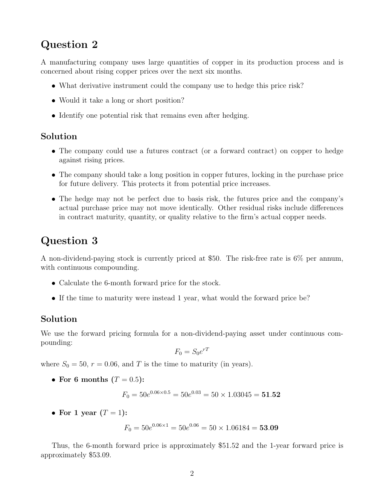

# Physical page 2 — raw extraction, needs review

<a id="page-2"></a>



Raw layout text below may flatten formulas, tables and glyphs. The image is source evidence; no semantic verification is claimed.

```text
Question 2
A manufacturing company uses large quantities of copper in its production process and is
concerned about rising copper prices over the next six months.
   ˆ What derivative instrument could the company use to hedge this price risk?

   ˆ Would it take a long or short position?

   ˆ Identify one potential risk that remains even after hedging.

Solution
   ˆ The company could use a futures contract (or a forward contract) on copper to hedge
     against rising prices.
   ˆ The company should take a long position in copper futures, locking in the purchase price
     for future delivery. This protects it from potential price increases.
   ˆ The hedge may not be perfect due to basis risk, the futures price and the company’s
     actual purchase price may not move identically. Other residual risks include differences
     in contract maturity, quantity, or quality relative to the firm’s actual copper needs.


Question 3
A non-dividend-paying stock is currently priced at $50. The risk-free rate is 6% per annum,
with continuous compounding.

   ˆ Calculate the 6-month forward price for the stock.

   ˆ If the time to maturity were instead 1 year, what would the forward price be?

Solution
We use the forward pricing formula for a non-dividend-paying asset under continuous com-
pounding:
                                       F0 = S0 erT
where S0 = 50, r = 0.06, and T is the time to maturity (in years).

   ˆ For 6 months (T = 0.5):

                         F0 = 50e0.06×0.5 = 50e0.03 = 50 × 1.03045 = 51.52

   ˆ For 1 year (T = 1):

                         F0 = 50e0.06×1 = 50e0.06 = 50 × 1.06184 = 53.09

   Thus, the 6-month forward price is approximately $51.52 and the 1-year forward price is
approximately $53.09.

                                               2

```
