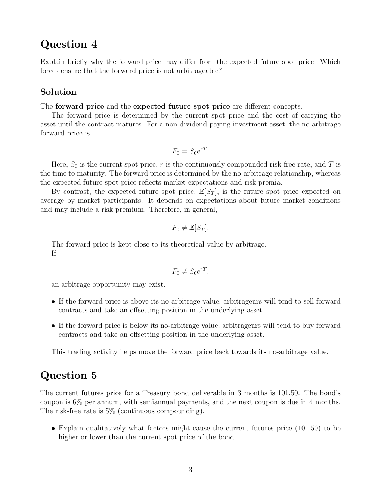

# Physical page 3 — raw extraction, needs review

<a id="page-3"></a>



Raw layout text below may flatten formulas, tables and glyphs. The image is source evidence; no semantic verification is claimed.

```text
Question 4
Explain briefly why the forward price may differ from the expected future spot price. Which
forces ensure that the forward price is not arbitrageable?

Solution
The forward price and the expected future spot price are different concepts.
   The forward price is determined by the current spot price and the cost of carrying the
asset until the contract matures. For a non-dividend-paying investment asset, the no-arbitrage
forward price is

                                          F0 = S0 erT .
   Here, S0 is the current spot price, r is the continuously compounded risk-free rate, and T is
the time to maturity. The forward price is determined by the no-arbitrage relationship, whereas
the expected future spot price reflects market expectations and risk premia.
   By contrast, the expected future spot price, E[ST ], is the future spot price expected on
average by market participants. It depends on expectations about future market conditions
and may include a risk premium. Therefore, in general,

                                          F0 ̸= E[ST ].

   The forward price is kept close to its theoretical value by arbitrage.
   If

                                          F0 ̸= S0 erT ,
   an arbitrage opportunity may exist.

   ˆ If the forward price is above its no-arbitrage value, arbitrageurs will tend to sell forward
     contracts and take an offsetting position in the underlying asset.

   ˆ If the forward price is below its no-arbitrage value, arbitrageurs will tend to buy forward
     contracts and take an offsetting position in the underlying asset.

   This trading activity helps move the forward price back towards its no-arbitrage value.


Question 5
The current futures price for a Treasury bond deliverable in 3 months is 101.50. The bond’s
coupon is 6% per annum, with semiannual payments, and the next coupon is due in 4 months.
The risk-free rate is 5% (continuous compounding).

   ˆ Explain qualitatively what factors might cause the current futures price (101.50) to be
     higher or lower than the current spot price of the bond.


                                                3

```
