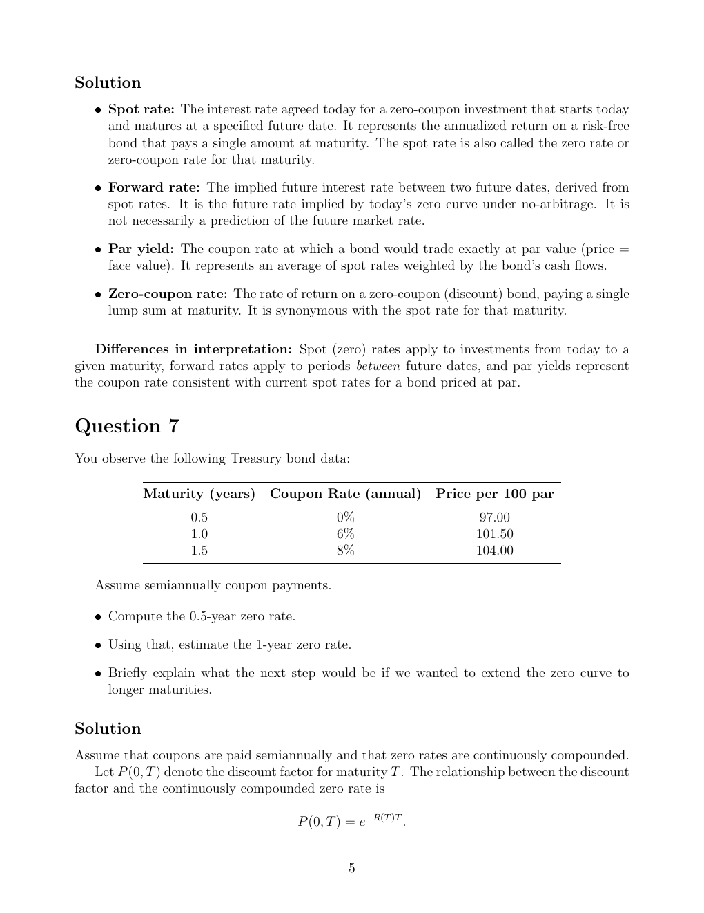

# Physical page 5 — raw extraction, needs review

<a id="page-5"></a>



Raw layout text below may flatten formulas, tables and glyphs. The image is source evidence; no semantic verification is claimed.

```text
Solution
   ˆ Spot rate: The interest rate agreed today for a zero-coupon investment that starts today
     and matures at a specified future date. It represents the annualized return on a risk-free
     bond that pays a single amount at maturity. The spot rate is also called the zero rate or
     zero-coupon rate for that maturity.

   ˆ Forward rate: The implied future interest rate between two future dates, derived from
     spot rates. It is the future rate implied by today’s zero curve under no-arbitrage. It is
     not necessarily a prediction of the future market rate.

   ˆ Par yield: The coupon rate at which a bond would trade exactly at par value (price =
     face value). It represents an average of spot rates weighted by the bond’s cash flows.

   ˆ Zero-coupon rate: The rate of return on a zero-coupon (discount) bond, paying a single
     lump sum at maturity. It is synonymous with the spot rate for that maturity.

   Differences in interpretation: Spot (zero) rates apply to investments from today to a
given maturity, forward rates apply to periods between future dates, and par yields represent
the coupon rate consistent with current spot rates for a bond priced at par.


Question 7
You observe the following Treasury bond data:

            Maturity (years)      Coupon Rate (annual)          Price per 100 par
                    0.5                       0%                        97.00
                    1.0                       6%                       101.50
                    1.5                       8%                       104.00

   Assume semiannually coupon payments.

   ˆ Compute the 0.5-year zero rate.

   ˆ Using that, estimate the 1-year zero rate.

   ˆ Briefly explain what the next step would be if we wanted to extend the zero curve to
     longer maturities.

Solution
Assume that coupons are paid semiannually and that zero rates are continuously compounded.
    Let P (0, T ) denote the discount factor for maturity T . The relationship between the discount
factor and the continuously compounded zero rate is

                                       P (0, T ) = e−R(T )T .


                                                 5

```
