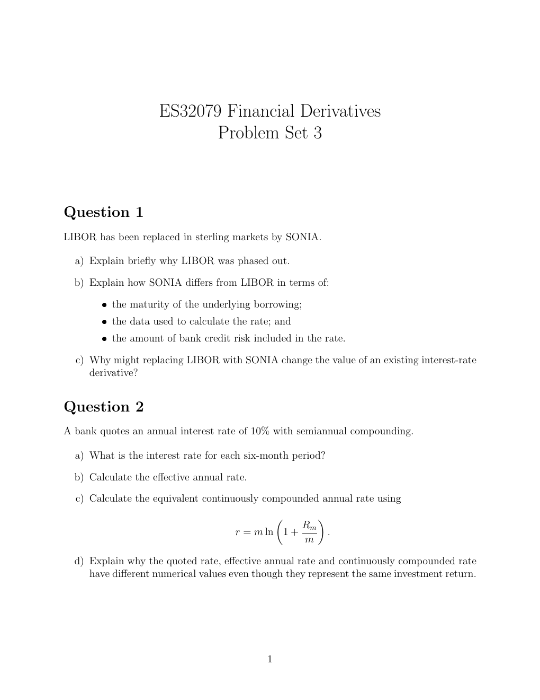

# Physical page 1 — raw extraction, needs review

<a id="page-1"></a>



Raw layout text below may flatten formulas, tables and glyphs. The image is source evidence; no semantic verification is claimed.

```text
                     ES32079 Financial Derivatives
                            Problem Set 3


Question 1
LIBOR has been replaced in sterling markets by SONIA.

  a) Explain briefly why LIBOR was phased out.

  b) Explain how SONIA differs from LIBOR in terms of:

        ˆ the maturity of the underlying borrowing;
        ˆ the data used to calculate the rate; and
        ˆ the amount of bank credit risk included in the rate.

  c) Why might replacing LIBOR with SONIA change the value of an existing interest-rate
     derivative?


Question 2
A bank quotes an annual interest rate of 10% with semiannual compounding.

  a) What is the interest rate for each six-month period?

  b) Calculate the effective annual rate.

  c) Calculate the equivalent continuously compounded annual rate using
                                                     
                                                   Rm
                                      r = m ln 1 +      .
                                                   m

  d) Explain why the quoted rate, effective annual rate and continuously compounded rate
     have different numerical values even though they represent the same investment return.


                                            1

```
