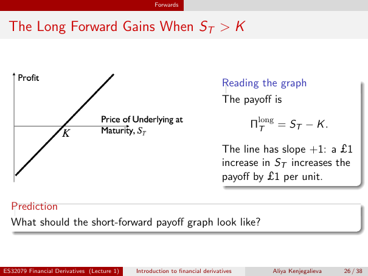
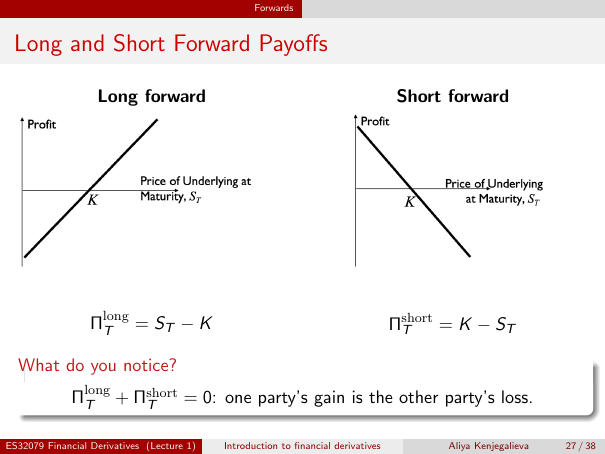

# Draw and interpret both forward payoff graphs

**Unreviewed teaching draft — Lecture 1, physical pages 26–27.** Exact source units are cited below. Explanations, numerical graph coordinates, practice and answers are labelled **supplemental**, not official solutions. The source graphs' **Profit** labels are preserved, not silently changed. This draft is not teaching approval, investment advice or a learner-progress record.

## Why draw the formula?

A payoff graph lets you see many possible maturity prices at once. It shows which side gains from a price increase and whether a loss disappears. It does not forecast which price will occur.

1. **Explain:** describe the axes, fixed delivery price, zero crossing, signs and mirror relationship in both original diagrams; distinguish a maturity-price graph from a time path and explain the source's Profit/payoff caveat. Success requires every axis and direction correct, including the assumptions needed for equality with profit.
2. **Apply:** given a fixed delivery price and quantity, compute and plot at least three coordinates for long and short, calculate slopes, check zero-sum, and identify the payoff-zero price. Diagnose a clipped-at-zero graph and an unjustified loss bound. Currency coordinates must be correct to the penny; explain their units and physical delivery interpretation.

Prerequisite: [currency payoff and units](lesson-l1-currency-forwards.md#payoff-formula). **Supplemental readiness check:** if you receive an asset worth £80 and pay £100, is net value +£20 or −£20? It is −£20; a receipt does not by itself determine the net sign. The next section supplies the graph foundation without assuming earlier graph training.

## 1. Foundation: a point means a possible outcome — supplemental

A graph has a **horizontal axis** (left to right) and **vertical axis** (down to up). A coordinate pair **(x, y)** means go to horizontal value x and read vertical value y. Here x is a **possible spot price at maturity**, not a date; y is the corresponding net economic payoff. One point is one possible outcome, not one step in time. A **straight line** has the same change in y for every equal change in x. Its **slope** is change in vertical value divided by change in horizontal value; upward to the right is positive, downward negative.

**Long** means obliged to buy the underlying asset; **short** means obliged to sell it. An **underlying unit** is the agreed asset quantity used to quote the price. The **spot price** is the price for immediate exchange at the observed date. **Maturity** is the agreed future delivery date. A **payoff** values the contract exchange then; **profit** additionally includes any earlier payment and other costs on a consistent time basis. Physical delivery exchanges an asset for cash: its valued net payoff is not extra cash on top.

| Symbol | Definition before use | Unit |
|---|---|---|
| $T$ | Delivery date, held fixed while drawing a graph | Date, not the horizontal variable |
| $S_T$ | Market price at that date, varied across horizontal coordinates | GBP (£) per underlying unit in our numerical examples |
| $K$ | Contract delivery price fixed at agreement | Same GBP per underlying unit |
| $\Pi_T^{\mathrm{long}}$, $\Pi_T^{\mathrm{short}}$ | One-underlying-unit maturity payoff for buyer/seller | GBP per underlying unit; superscripts are side labels |
| $Q$ | Positive number of underlying units for a total-payoff extension | Underlying units |

**Local assumptions:** same asset, quantity, delivery date and currency on the two sides; both perform; no additional transaction or financing costs. Our simplified numerical contracts also have **zero initial value/no premium**, so their terminal payoff equals their forward-position profit. These assumptions are ours, not written on the original figure axes. No interest rate, annualisation, discounting or pricing model is used. We are not valuing the position today or either party's entire business.

## 2. Read the original long diagram faithfully

**Accessible original description:** p26's left graph has horizontal label **“Price of Underlying at Maturity, $S_T$”**, increasing rightward, and vertical label **“Profit”**, increasing upward. There are no numerical ticks, explicit currency-unit labels or legend. A solid black line rises from below the horizontal axis at the left, crosses it at **$K$**, and continues above it to the right. The labelled crossing is a price on the horizontal axis, not a payment on the vertical axis. [L1 physical p26, left diagram; `lecture-1-p026-long-forward-diagram`](../../sources/annotated/lecture-1/page-026.md#lecture-1-p026-long-forward-diagram).

**Preserved source conflict:** the figure says **Profit**, whereas the accompanying formula describes **payoff**. They coincide only under zero-initial-value/no-premium and no additional financing/transaction-cost assumptions for the forward position. With other cash flows, profit needs separate accounting. We retain the original label and use “payoff” for our annotated numerical coordinates below. We do not infer a currency or an exact numerical scale from the image.

## 3. Build the rising line from the exchange

The source states

$$\Pi_T^{\mathrm{long}}=S_T-K,$$

with slope **+1**, explaining that a £1 increase in the underlying price adds £1 payoff per unit. [L1 physical p26, right reading box; `lecture-1-p026-long-forward-slope`](../../sources/annotated/lecture-1/page-026.md#lecture-1-p026-long-forward-slope).

**Supplemental derivation:** receive one unit worth $S_T$, pay $K$, so net value is $S_T-K$. Hold $K$ fixed. A higher $S_T$ changes only the received asset value; it cannot change the already agreed payment. If $S_T$ rises by £1/unit, payoff rises by £1/unit: slope is (£1/unit)/(£1/unit) = **+1**, dimensionless for the per-unit graph. At $S_T=K$, subtracting equal prices gives zero. Left of $K$ the long pays more than market value and has a negative payoff; right of $K$ it pays less and has a positive one.

**Supplemental construction recipe:** choose $K=£100$ per unit, one unit delivered. Put maturity price in £/unit on the horizontal axis and payoff in £/unit on the vertical. Calculate points before drawing:

| Horizontal $S_T$ (£/unit) | Vertical long payoff (£/unit) | Coordinate |
|---:|---:|---|
| 80 | 80 − 100 = −20 | (80, −20) |
| 100 | 100 − 100 = 0 | (100, 0) |
| 120 | 120 − 100 = +20 | (120, 20) |

Plot the three points and join them by a straight line. From the first to the second, vertical change = 0 − (−20) = +20 and horizontal change = 100 − 80 = +20; slope = 20/20 = **+1**. The next interval gives the same slope. The negative part is not erased: a forward is an obligation, not a right you abandon when unattractive.

## 4. Predict the short before looking at the pair

The source asks what the short graph should look like. [L1 physical p26, lower prediction box; `lecture-1-p026-short-graph-prediction`](../../sources/annotated/lecture-1/page-026.md#lecture-1-p026-short-graph-prediction).

**Supplemental reasoning:** reverse the exchange. The short receives $K$ and delivers an asset worth $S_T$. Its net is $K-S_T$, the negative of the long's. Negating a graph's y values reflects it across the **horizontal zero-payoff axis**, not across the vertical axis. It still crosses at the same positive $K$. At £80 with $K=£100$, short payoff is +£20 per unit; at £120 it is −£20. Therefore predict a falling line, positive left of $K$ and negative right of $K$, with slope **−1**.

## 5. Inspect both diagrams and equations on p27

**Left, long:** horizontal label **“Price of Underlying at Maturity, $S_T$”**; vertical label **“Profit”**. Its solid black line rises through zero at $K$, negative on the left and positive on the right. The equation beneath is $\Pi_T^{\mathrm{long}}=S_T-K$. No numerical ticks, currency units or legend are supplied. [L1 physical p27, upper-left graph and equation; `lecture-1-p027-paired-long-diagram`](../../sources/annotated/lecture-1/page-027.md#lecture-1-p027-paired-long-diagram).

**Right, short:** the same horizontal maturity-price label and vertical **“Profit”** label. The solid black line slopes downward from positive values, crosses zero at $K$ and continues negative to the right. The equation beneath is

$$\Pi_T^{\mathrm{short}}=K-S_T.$$

Again there are no numerical ticks, currency units or legend. [L1 physical p27, upper-right graph and equation; `lecture-1-p027-paired-short-diagram`](../../sources/annotated/lecture-1/page-027.md#lecture-1-p027-paired-short-diagram). **The same source-label caveat applies to both p27 plots**, not only p26: payoff equals profit only with the explicit zero-initial-value/no-premium and no additional financing/transaction-cost assumptions stated above.

**Supplemental matched numerical table:** retain one underlying unit, $K=£100$ per unit and the assumptions already stated.

| $S_T$ (£/unit) | Long payoff (£/unit) | Short payoff (£/unit) | Sum (£/unit) |
|---:|---:|---:|---:|
| 80 | −20 | +20 | 0 |
| 100 | 0 | 0 | 0 |
| 120 | +20 | −20 | 0 |

The short slope from the first row to the second is (0 − 20)/(100 − 80) = **−20/20 = −1**. Neither line is a forecast, a price history or a statement that the short position always loses.

## 6. Why the two payoffs cancel, and what cancellation does not mean

The source states

$$\Pi_T^{\mathrm{long}}+\Pi_T^{\mathrm{short}}=0.$$

[L1 physical p27, lower observation box; `lecture-1-p027-forward-zero-sum`](../../sources/annotated/lecture-1/page-027.md#lecture-1-p027-forward-zero-sum).

**Supplemental stepwise check:** substitute both sides: $(S_T-K)+(K-S_T)$. Group the asset values $S_T-S_T=0$ and cash legs $-K+K=0$. The result is zero for **matched opposite sides of the same exchange**, before costs. Two arbitrary trades with different prices or quantities need not cancel. The result does not imply that neither party needs money to perform, that no business risk can be reduced, or that each party's total profit after its own costs is zero. It simply accounts for the two sides of this value exchange.

## 7. Scale the graph and state its domain — supplemental

For total payoffs, multiply the whole per-unit difference:

$$P_{\mathrm{long}}=Q(S_T-K),\qquad P_{\mathrm{short}}=Q(K-S_T).$$

Here $P$ means **total** payoff in GBP, unlike the per-unit $\Pi$ above. With horizontal units still GBP/unit and vertical total GBP, the numerical slopes are **+$Q$ and −$Q$** (their units are underlying units). More units increase sensitivity; they do not move the zero crossing away from $S_T=K$.

**Complete worked extension:** three units, $K=£100$/unit, $S_T=£120$/unit. Long receives assets worth 3 × £120 = **£360**, pays 3 × £100 = **£300**, and has total payoff **+£60**. Short receives £300, delivers assets worth £360, and has **−£60**. At $S_T=£80$/unit the long payoff is 3 × (80 − 100) = **−£60**, short +£60. At £100 both are zero. Long total-payoff slope between £100 and £120 is (60 − 0)/(120 − 100) = **3 underlying units**. Currency arithmetic is exact; there is no rounding.

**Bounds depend on allowed prices:** if a particular asset's permitted maturity-price domain is $S_T\ge0$ and $K$ is positive, one-unit long payoff cannot fall below $-K$, and short payoff cannot exceed $K$. Those conclusions use the stated price-domain assumption, not the line formula alone. Do not claim that every commodity price must be nonnegative. If negative prices are possible for the specified asset/contract, the graph must extend into that domain and those bounds do not follow. Likewise claims of unlimited gain/loss require allowing prices to rise without a specified upper bound. The source pictures do not establish universal bounds.

**Break-even caution:** $S_T=K$ is the **payoff-zero** point. It is also a profit break-even only under the local no-premium/no-additional-cost assumptions. Adding costs need not leave profit zero there. The diagram does not establish a present contract value or the cost of acquiring an asset before delivery.

## 8. Graded practice — supplemental; answers are separate

Exercises 1–3 assess outcome 1; 4–6 assess outcome 2. Every answer is an authored explanation, not an official supplied solution.

### Exercise 1 — scaffold: read an original

Describe p26's horizontal and vertical labels exactly, the line's direction, the meaning of $K$, the signs on each side and the numerical information absent from the picture. Is the horizontal axis time? Why must an explanation distinguish its Profit label from the payoff formula? [Answer 1](#exercise-axes-answer).

### Exercise 2 — transfer: predict without numbers

Starting from the long's asset/payment legs, reverse them for the short. Predict the short's slope, zero crossing and signs. Name the axis across which it reflects the long and explain why the losing side does not get to replace its payoff by zero. [Answer 2](#exercise-predict-answer).

### Exercise 3 — teach back both originals

Explain both p27 graphs to someone unable to see them. Include axes/geometry, their relation to p26, absent scale/units, the Profit-label assumptions and what “one party's gain is the other's loss” does and does not say about business profit and funding. [Answer 3](#exercise-explain-answer).

### Exercise 4 — scaffold: calculate, then draw

One underlying unit, $K=£100$/unit; possible $S_T$ values are £80, £100 and £120 per unit. Calculate long/short coordinates and sums, label both axes and draw both straight lines. Compute each slope from two points, mark the zero crossing, and explain what physically happens at the zero-payoff point. Use the local assumptions. [Answer 4](#exercise-draw-answer).

### Exercise 5 — transfer: change quantity and delivery price

Now take four underlying units, $K=£105$/unit. Find total payoffs at $S_T=£90$, £105 and £120 per unit. Show actual asset/cash values at £90, both total-payoff slopes and the zero crossing. If the permitted price domain is nonnegative, what are the conditional long minimum and short maximum? Would these bounds follow if negative prices were allowed? [Answer 5](#exercise-scale-answer).

### Exercise 6 — diagnose and teach back

Correct: “A forward's long line stops at zero when it would lose; its x-axis shows time; +£60 means receiving £60 extra on top of physical delivery; the two parties cancel so neither needs to pay; commodity prices cannot be negative; payoff and profit are always the same.” Use a coordinate, an exchange and the appropriate assumptions, not just six yes/no answers. [Answer 6](#exercise-apply-answer).

## 9. Supplemental answers, feedback and retries

### Answer 1

Horizontal: **Price of Underlying at Maturity, $S_T$**; vertical: **Profit**. The solid black line rises, crosses zero at delivery price $K$, is negative for $S_T<K$ and positive for $S_T>K$. There are no numerical ticks, currency-axis units or legend. Horizontal movement compares possible prices at the same maturity, not time passing. The formula measures payoff; to call it profit requires zero initial value/no premium and no additional financing/transaction costs. **Retry:** describe (price, payoff) in words; if you said “later,” replace it with “a higher possible price at the same date.”

### Answer 2

Long receives the asset and pays $K$: $S_T-K$. Short delivers it and receives $K$: $K-S_T$. The short's slope is **−1** per unit; it crosses at the same $K$, is positive to the left and negative to the right. It reflects across the **horizontal zero-payoff axis**. Both sides owe performance, so the unfavourable segment remains; clipping it would introduce a choice this forward does not give. **Retry:** at $S_T>K$, which party delivers the valuable asset for the lower fixed payment? The short; its payoff must be negative.

### Answer 3

A sufficient teach-back describes p27's two black straight lines against horizontal maturity spot price and vertical **Profit**: long rises through $K$, as on p26, while short falls through the same $K$. At each fixed price their vertical values are equal in magnitude and opposite in sign. No exact numerical scale, currency units or legend appear. The formulas below the plots are payoffs; profit equality needs zero initial value/no premium and no extra financing/transaction costs. Zero-sum compares matched forward legs before costs, not entire businesses. Someone still has to deliver the asset and someone still pays cash. **Retry:** name one positive long point and its negative short counterpart, then explain the actual gross exchange rather than saying “nothing happens.”

### Answer 4

Long points: **(80, −20), (100, 0), (120, 20)**. Short points: **(80, 20), (100, 0), (120, −20)**. Both axes use GBP per underlying unit; the horizontal is $S_T$ and vertical is payoff. Row sums are all **0**. Join each set linearly without clipping losses. Long slope = (0 − (−20))/(100 − 80) = **+1**; short = (0 − 20)/(100 − 80) = **−1**. Both cross at **$S_T=£100$/unit**. With one unit, the long still pays £100 and receives the asset worth £100: zero net value is not zero gross transfer. **Retry:** if your line crosses at zero price, set $S_T-K=0$ and solve for $S_T$ before redrawing.

### Answer 5

| $S_T$ (£/unit) | Total long payoff (£) | Total short payoff (£) | Sum (£) |
|---:|---:|---:|---:|
| 90 | 4(90 − 105) = −60 | +60 | 0 |
| 105 | 4(105 − 105) = 0 | 0 | 0 |
| 120 | 4(120 − 105) = +60 | −60 | 0 |

At £90 the long receives four units worth 4 × £90 = **£360** and pays 4 × £105 = **£420**, net −£60; the short's legs reverse. Total-payoff slopes are **+4 and −4 underlying units**: for example (60 − 0)/(120 − 105) = 60/15 = 4. Both zero crossings stay at **£105/unit**. Under $S_T\ge0$, long minimum at zero price is **−£420** and short maximum **+£420**. If the asset permits negative prices, these bounds no longer follow. **Retry:** if you wrote a slope of one for the total graph, compare four units' total £4 payoff change to a £1/unit spot change.

### Answer 6

A long forward keeps its losses: for one unit with $K=£100$ and $S_T=£80$, the point is (80, −20), not (80, 0). The horizontal coordinate is a possible maturity price, not time. In the three-unit worked example at £120, receive assets worth £360 and pay £300: +£60 is net value, not a third transfer. Zero-sum does not remove those gross deliveries or the need to fund them. Price bounds require an explicit allowed-price domain; nonnegativity is not universal for commodities. Payoff equals forward-position profit only under the zero-initial-value/no-premium and no-additional-financing/transaction-cost assumptions; neither is total business profit. **Retry:** choose the first wrong assertion, reconstruct its two legs or axes, and then explain the full graph in your own words.

## Stop and check

Attempt exercises 3 and 6 aloud or in private notes. A tutor should separately check axes, signs, slope, units, physical transfers and caveats; a correct sketch with the wrong interpretation is insufficient. No response belongs in this authored lesson. Next: [futures obligations and daily settlement](lesson-l1-futures-settlement.md#outcomes). Current valuation and pricing models are outside this graph lesson.

## Full inspected evidence

All six substantive units on the two pages are cited above. Canonical source verification does not approve this teaching; historical normalized headers remain unchanged.

| Physical page | Full normalized span | Unchanged raw span | Original PNG |
|---|---|---|---|
| 26 | [Full p26](../../sources/annotated/lecture-1/page-026.md) | [Raw p26](../../sources/extracted/lecture-1/page-026.md#page-26) | [Original p26](../../sources/assets/lecture-1/page-026.png) |
| 27 | [Full p27](../../sources/annotated/lecture-1/page-027.md) | [Raw p27](../../sources/extracted/lecture-1/page-027.md#page-27) | [Original p27](../../sources/assets/lecture-1/page-027.png) |
