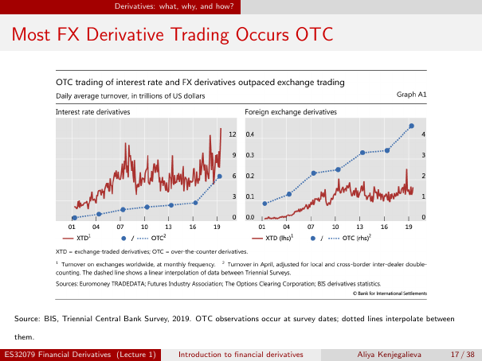

# Read derivative-market charts and classify positions

**Unreviewed teaching draft.** This lesson teaches six substantive units from Lecture 1, physical pages 17–19. It interprets the **supplied historical chart**, not today's market or a forecast. Exact citations identify source evidence; hypothetical numbers, explanations and added exercises are labelled supplemental. Page 19 supplies its own three classifications, which are explicitly attributed rather than presented as newly discovered answers.

## Why a plausible chart reading can be wrong

**Supplemental motivation:** two coloured lines can appear equally high while representing amounts ten times apart. A large trading volume can be mistaken for money at risk. And two people can buy the same derivative for opposite purposes. Reliable reading starts with labels, scales, dates and existing exposures—not with the apparent shape of a line or the product name.

## Observable outcomes

1. **Read both chart panels with their provenance:** identify the measure, units, calendar ticks, series and axes; describe the historical interest-rate and FX patterns with appropriate approximation; distinguish survey observations from interpolation; answer all three source chart questions. Success means using the separate FX scales correctly, retaining the 2019 historical source context, and rejecting turnover-as-risk and forecast claims. On a hypothetical two-axis example, show a correct numerical comparison without treating it as observed data.
2. **Classify positions by exposure and strategy:** classify all three source positions and new matched examples as hedging, speculation or arbitrage, explaining the existing exposure or price-inconsistency mechanism. Success means attributing the supplied source answers, showing why the same purchase can serve different purposes, and stating the execution/equivalence/cost assumptions before calling a price gap an arbitrage.

**Supplemental readiness check:** if two lines share the same vertical height, must they have the same value? The next section supplies the scale bridge. The preceding [markets and clearing lesson](lesson-l1-markets-and-clearing.md) is helpful; the definitions needed now are repeated here. Planned concept reference: `concept-derivative-contracts`; the chart-unit arithmetic bridge is embedded rather than assumed.

## 1. Foundations: what is being counted? — supplemental

A **derivative** depends on an underlying asset, rate, index or event. **FX** means foreign exchange, involving currencies; **interest-rate derivatives** refer to interest rates. These labels name product categories, not what the vertical axis measures. **XTD** means exchange-traded derivatives; **OTC** means over-the-counter, privately negotiated derivatives. An OTC trade may be centrally cleared: the categories here describe trading markets, not necessarily clearing status.

A graph's **horizontal axis** locates time; its **vertical axis** gives numerical magnitude. A **legend** tells which colour/symbol belongs to each series. **lhs** means left-hand scale; **rhs** means right-hand scale. With two scales, identify the series' assigned axis before reading its value. Never compare coloured heights first and labels afterwards.

**Turnover** is trading activity over a period. **Daily average turnover** averages that activity per day under the chart's measurement conventions. Here the money unit is **trillions of US dollars**, not pounds, percentages, contract counts or the exchange rate. One trillion US dollars is **$1,000,000,000,000**; 0.1 trillion is **$100,000,000,000**, or $100 billion. These are amount units per average trading day, not an annual interest-rate convention.

Turnover is not the same as:

- **Outstanding contracts/exposure:** what remains open at a point in time; activity over a period and a stock at a date are different measures.
- **Current market value:** what the contract is worth now.
- **Money that will be lost:** loss depends on market moves, contractual sensitivities, offsetting positions, collateral, default and other conditions. A trading-activity total alone does not determine it.

An **observation** is a measured data point. An **interpolation** fills the gap between observations according to a rule; it is not another measurement. A **triennial** survey happens every three years. These distinctions matter for the dotted OTC series below.

## 2. The original chart and its accessible reading

The slide title is **“Most FX Derivative Trading Occurs OTC.”** The embedded Graph A1 title is **“OTC trading of interest rate and FX derivatives outpaced exchange trading”**, with subtitle **“Daily average turnover, in trillions of US dollars.”** Do not turn a headline into a claim that OTC levels exceed exchange levels in both panels; inspect each panel's actual values and scale. The following is an accessible description, **not digitised observations**.

### Left panel: interest-rate derivatives

**Source figure transcription:** title **Interest rate derivatives**. Horizontal ticks are **01, 04, 07, 10, 13, 16, 19**, representing the historical calendar years 2001, 2004, 2007, 2010, 2013, 2016 and 2019. Its vertical scale is on the panel's **right**, labelled **0, 3, 6, 9, 12**, in trillions of US dollars of daily average turnover. The **red solid jagged line is XTD**; **blue circles joined by dotted segments are OTC**. [L1 physical p17, embedded Graph A1, left interest-rate derivatives panel; `lecture-1-p017-chart-interest-rate`](../../sources/annotated/lecture-1/page-017.md#lecture-1-p017-chart-interest-rate).

**Source pattern, approximate visual description:** red XTD varies markedly and finishes above the labelled 12-trillion tick; blue OTC rises from near zero in 2001 to about 6 trillion at the last survey point. The two series use this panel's common scale, so the red terminal level is visibly higher than the blue terminal level. These are approximate visual descriptions, not exact endpoint values or a claim that every intermediate change is measured in the same way.

**Supplemental interpretation:** “interest rate” does not make the vertical labels 3%, 6% or 12%. They are US-dollar activity amounts. The embedded headline's “outpaced” must not be substituted for an exact growth-rate calculation or proof of which series has the greater level at each date; this image supplies no exact underlying data table for such a calculation.

### Right panel: foreign-exchange derivatives

**Source figure transcription:** title **Foreign exchange derivatives**, with the same year ticks **01, 04, 07, 10, 13, 16, 19**. The two series use **different vertical axes**:

| Series and appearance | Assigned axis | Printed ticks | Unit |
|---|---|---|---|
| Red solid/jagged XTD, labelled **XTD (lhs)** | Left-hand scale | 0.0, 0.1, 0.2, 0.3, 0.4 | Trillions of US dollars, daily average turnover |
| Blue circles/dotted OTC, labelled **OTC (rhs)** | Right-hand scale | 0, 1, 2, 3, 4 | Same unit, different scale |

[L1 physical p17, embedded Graph A1, right foreign-exchange derivatives panel; `lecture-1-p017-chart-fx`](../../sources/annotated/lecture-1/page-017.md#lecture-1-p017-chart-fx).

**Source pattern, approximate visual description:** the blue survey observations increase from below 1 trillion to above 4 trillion at the last point. The red series fluctuates on its much smaller left scale, ending around 0.1–0.2 trillion. Reading the appropriate axes supports the slide's historical claim that most FX derivative trading in this evidence occurs OTC. Do not infer an exact market share or ratio from those approximate endpoints. Equal plotted heights would **not** imply equal turnover.

### Provenance, frequency and the dotted line

**Source legend/footnotes/captions:** XTD means exchange-traded derivatives and OTC over-the-counter derivatives. Footnote 1 describes worldwide exchange turnover at **monthly frequency**. Footnote 2 describes **turnover in April**, adjusted for **local and cross-border inter-dealer double-counting**, and says the dashed line is a **linear interpolation between Triennial Surveys**. The chart's sources are **Euromoney TRADEDATA; Futures Industry Association; The Options Clearing Corporation; BIS derivatives statistics**, with Bank for International Settlements copyright. The slide's lower caption identifies **BIS, Triennial Central Bank Survey, 2019**, and explains that OTC observations occur at survey dates and dotted lines interpolate between them. [L1 physical p17, embedded graph legend, footnotes, sources and lower source caption; `lecture-1-p017-chart-provenance`](../../sources/annotated/lecture-1/page-017.md#lecture-1-p017-chart-provenance).

**Supplemental explanation:** a dealer is an institution taking a side in trades. If both dealers report the same trade, naïvely adding reports can count it twice; the stated adjustment addresses that measurement problem. “Monthly frequency” means exchange observations are available month by month, not that the vertical scale is a monthly total. “April” identifies the survey's activity measurement window; “2019” is the source context, not a statement about today's volumes.

A straight connection between two OTC survey points depicts an assumed linear path between measured dates. It does not prove actual activity rose smoothly or that monthly OTC observations were measured all along that line. The two series therefore differ in observation frequency as well as market category. Describe what the chart shows before speculating about causes; this figure alone cannot establish why trading changed or predict the future.

## 3. Worked two-axis comparison — supplemental numbers, not chart observations

Use the **same FX scale layout**, but invent two points solely to practise reading axes. Suppose a red XTD point is at **0.2 trillion** on the left scale, and a blue OTC point is at **2 trillion** on the right scale. They can sit at the same vertical height because the scale labels differ.

**Supplemental calculation rules, defined before use:** subtract values in the same units for a difference; divide the comparison amount by a **nonzero** reference amount for a ratio. Plain-text formulas: **difference = blue amount − red amount**; **ratio = blue amount ÷ red amount**. These operations use values read from the assigned axes, not pixel heights. We are not estimating an exact historical chart ratio.

1. Record units first: red = **0.2 trillion US dollars per average day**; blue = **2 trillion US dollars per average day**.
2. Convert to a common smaller unit if helpful: 0.2 trillion = **200 billion**; 2 trillion = **2,000 billion**.
3. Difference: 2 − 0.2 = **1.8 trillion US dollars per average day**, equivalently 2,000 − 200 = **1,800 billion**.
4. Ratio: 2 ÷ 0.2 = **10**. The matching units cancel, so this ratio is dimensionless: OTC is ten times XTD in this **invented** example.
5. Check: 10 × 0.2 = 2. Comparing height instead would incorrectly give a ratio of 1. No rounding is needed.

## 4. Answer the slide's evidence questions, not an imagined one

The next source page asks: (1) what exactly is measured; (2) which market dominates FX derivative trading; (3) whether turnover can be interpreted as the amount of money at risk. The chart is on **page 17**; page 18 contains these questions, not another chart. [L1 physical p18, central read-the-evidence box; `lecture-1-p018-chart-reading-questions`](../../sources/annotated/lecture-1/page-018.md#lecture-1-p018-chart-reading-questions).

**Supplemental reasoning guide:** state **daily average turnover in trillions of US dollars**, use the FX panel's separate scales to conclude **OTC dominates in this historical evidence**, and answer **no** to turnover equalling money at risk. Qualify the time period and measurement conventions. Do not replace turnover with outstanding notional, current contract values or realised losses.

**Supplemental activity-versus-position illustration:** suppose a trader buys an identical claim for £100 and later sells that same claim for £100, with no other holdings or costs. A deliberately simple gross transaction-activity tally is £100 + £100 = **£200**, while the claim holding after the offsetting sale is **zero** and the cash difference is **£0**. This is not a recreation of BIS's adjusted methodology and does not assert that all round trips are riskless while open. It shows why adding activity need not describe the final position or loss. The chart's own counting adjustments still apply to its actual data.

## 5. Positions: the product name does not tell you the purpose

**Supplemental definitions:** a position is a holding or contractual commitment. **Futures** are standardised exchange-traded contracts with clearing and periodic settlement of gains/losses; their detailed cash mechanics are not needed for this classification. A buyer's position can benefit from rising underlying prices, but whether that risk offsets something else depends on what the buyer already needs or owns. **Hedging** reduces/transfers an existing risk; **speculation** takes risk for an expected return; **arbitrage** exploits inconsistent prices through matched feasible trades. “Equivalent” claims must have matching relevant economic terms, not merely similar names.

### The source's three positions

1. An airline buys oil futures **because it must purchase fuel in six months**.
2. A trader buys oil futures **because she expects oil prices to rise**.
3. A dealer **simultaneously buys and sells equivalent contracts quoted at inconsistent prices**.

[L1 physical p19, upper three-position box; `lecture-1-p019-position-classification`](../../sources/annotated/lecture-1/page-019.md#lecture-1-p019-position-classification).

**Supplemental reasoning before the answer:** underline the “because” clause rather than “buys oil futures.” The airline already has a business cost exposed to higher fuel prices. The trader's stated motive is a view about the market, not an existing purchase need. The dealer's description concerns a matched price inconsistency, not waiting for a forecast to come true. The source classifies the stated purposes; it does not provide quantities, hedge effectiveness calculations or full execution costs.

### Source-supplied classification key, with supplemental explanation

The lower source box says that purpose depends on existing exposure and supplies these corresponding answers: **(1) Hedging: offsets an existing business risk; (2) Speculation: deliberately takes market risk; (3) Arbitrage: exploits inconsistent prices.** [L1 physical p19, lower purpose box, three corresponding classifications; `lecture-1-p019-source-classification-answers`](../../sources/annotated/lecture-1/page-019.md#lecture-1-p019-source-classification-answers).

**Supplemental explanation:** the first two parties can enter the same product and same direction but for different reasons. A hedge need not remove every risk: oil futures and the airline's actual fuel bill may differ in product, amount or timing. A speculator may profit or lose; intention is not proof of outcome. For the dealer, the word “simultaneously” and the equivalence of contracts matter. A quoted gap alone is insufficient if costs, delivery conditions or execution uncertainty prevent locking it in.

## 6. Worked price-gap check — supplemental and conditional

Suppose an **identical transferable claim** can be bought for **£9** in one market and simultaneously sold for **£10** in another, with immediate transfer/settlement. Assume the same rights and quantity, executable prices for that quantity, sufficient funds to pay £9 and no other obligations. Fees total **£0.40** across both trades; no other cost or uncertain future cash flow remains. These are invented terms, not source market quotes.

1. Buy: pay **£9** and receive the claim.
2. Sell the same claim immediately: receive **£10** and deliver it. No claim position remains.
3. Before fees the cash difference is £10 − £9 = **£1**.
4. After fees: £1 − £0.40 = **£0.60** locked-in cash gain under the assumptions.
5. Check: £9 purchase + £0.40 fees + £0.60 gain = £10 receipt. If fees instead total **£1**, the net is **£0**; if fees are **£1.20**, it is **−£0.20**, so the apparent gap no longer offers a positive gain.

The **supplemental rule** is **net cash gain = sale proceeds − purchase cost − total fees**, all in pounds at the same time. No discounting or annualisation is used. Results are exact to the penny. This small cash-and-transfer example isolates the inconsistency principle; it is not a complete derivatives arbitrage strategy. Non-equivalent contracts or an uncertain second execution would invalidate its premise even if the arithmetic looked attractive.

## Misconceptions and limits — supplemental

- The right FX panel uses two axes; equal height is not equal value. Do not use its left scale for the blue series.
- The left panel's scale is money turnover, not an interest rate, and the right panel is not plotting a currency exchange rate.
- Dotted interpolation is not monthly measured OTC data; the historical chart is not a forecast or a current-market estimate.
- “OTC dominates FX” does not say OTC has the greater level in the interest-rate panel or that it necessarily has greater loss exposure.
- Activity, outstanding positions, market value and money at risk are different. Large turnover does not alone establish either safety or danger.
- Buying futures does not by itself classify hedging or speculation. Existing exposure and strategy matter.
- The source's arbitrage label describes the inconsistent-price example; a real implementation still needs equivalent claims, feasible timing and costs checked.

## Practice — attempt first

Source classifications are already visible above; explain the reason rather than copying the label. Added exercises/numbers and teaching answers are supplemental unless the source key is explicitly attributed.

### 1. Read labels before lines (outcome 1, scaffolded)

For **both** panels name the measure, unit, year-tick range and series styles. State the interest-rate panel's vertical tick values and compare its approximate final red/blue levels. Then give the FX red left-axis ticks and blue right-axis ticks. What do the blue circles and dotted connecting lines each represent? Name the slide's source/date and the difference in observation frequency. [Answer 1](#exercise-1-answer).

### 2. Apply a scale and reject a false risk claim (outcome 1, transfer)

Using the same FX scale layout, invent a red value of **0.3 trillion** and a blue value of **3 trillion** at the same plotted height. Calculate their difference and blue/red ratio in matching units; are these measured chart observations? Separately, a toy trader buys an identical claim for **£40** and sells it later for **£40**, with no costs or other holdings. Calculate the simple gross transaction tally, final claim holding and cash difference. Explain why this is not the BIS methodology or proof that no risk existed during the holding period. [Answer 2](#exercise-2-answer).

### 3. Teach the chart's message and limits (outcome 1, teach-back)

Answer all three page-18 questions in a short explanation: measure, FX-dominant market, turnover versus risk. Include the two-axis warning, historical 2019 source context, and why a dotted line cannot establish measured smooth monthly OTC growth or forecast future activity. [Answer 3](#exercise-3-answer).

### 4. Classify the source positions (outcome 2, scaffolded)

Classify the airline, trader and dealer on page 19, identify the source's supplied answer key, and justify each from the stated exposure/strategy. Why can the first two both buy oil futures but have different purposes? What hedge limitation is not quantified by the slide? [Answer 4](#exercise-4-answer).

### 5. Transfer purpose and test a price gap (outcome 2, transfer)

A manufacturer with a known future copper purchase buys a copper-price-linked contract to offset a higher bill. Another person with no copper exposure buys the same contract solely expecting a price rise. Classify both, explaining what you needed to know beyond the contract name. Separately, use the worked claim's £9 buy/£10 sell prices with **£0.70 total fees**: calculate net cash gain and state the assumptions needed to lock it in. Does replacing the second claim with a merely similar one preserve the conclusion? [Answer 5](#exercise-5-answer).

### 6. Explain why product names are insufficient (outcome 2, teach-back)

Respond to: “Every futures buyer is speculating, every trade that later makes money was a hedge, and any two-market price gap is arbitrage.” Use the source's three cases, distinguish intention/exposure from realised outcome, and state at least three checks needed for the dealer's matched strategy. [Answer 6](#exercise-6-answer).

## Answers, feedback and retries

### Answer 1 — supplemental figure-reading answer

Both panels measure **daily average turnover in trillions of US dollars**; ticks run **01, 04, 07, 10, 13, 16, 19**, meaning 2001 through 2019 at those labelled dates. Red solid jagged is XTD; blue circles/dotted connections are OTC. The interest-rate panel uses right-axis ticks **0, 3, 6, 9, 12**: red finishes above 12 and blue about 6, approximately, so the red final level is higher on that common scale. The FX panel uses red **left** ticks **0.0, 0.1, 0.2, 0.3, 0.4** and blue **right** ticks **0, 1, 2, 3, 4**.

Blue circles mark survey observations; dotted connections interpolate between them, rather than adding measured observations. The slide cites **BIS, Triennial Central Bank Survey, 2019**. The footnotes distinguish worldwide exchange turnover observed at monthly frequency from adjusted April OTC turnover at triennial survey dates. The adjustment covers local/cross-border inter-dealer double-counting; the complete source list is transcribed above.

**Feedback/retry:** if you wrote interest rates in percent, read the graph subtitle before interpreting the product-category heading. If you used one FX axis for both colours, retry: which legend includes “rhs”? Correct target: blue OTC uses the right axis.

### Answer 2 — supplemental arithmetic

Difference: 3 − 0.3 = **2.7 trillion US dollars per average day**. Ratio: 3 ÷ 0.3 = **10**, dimensionless; check 10 × 0.3 = 3. These are **invented scale-practice values**, not digitised historical observations. Equal height does not imply a ratio of 1.

Toy transaction tally: £40 + £40 = **£80**. After buying and selling the same claim, the final claim holding is **zero**; cash difference is £40 − £40 = **£0**. This simple gross tally omits the source's survey-specific aggregation/adjustment rules, so it is not a BIS reconstruction. The trader could have been exposed to price or counterparty risk while holding the claim; zero final holding and zero realised cash difference do not erase that fact. No rounding is needed.

**Feedback/retry:** if turnover became a loss estimate, identify exactly what was added: transaction amounts, not losses. Retry by listing each cash receipt/payment separately from the final asset holding.

### Answer 3 — supplemental model/checklist

“The supplied historical chart measures daily average derivative turnover in trillions of US dollars, not the money at risk. Its FX panel supports OTC dominance when we read the red XTD left axis and blue OTC right axis correctly; equal plotted height would not mean equal amounts. The slide cites the BIS Triennial Central Bank Survey, 2019, so I am not claiming current market volumes. Blue circles are survey observations, and the dotted lines interpolate between them rather than report every month's OTC activity. Turnover alone does not reveal outstanding net positions, contract values or potential losses, and the historical picture does not forecast future trading.”

Check the measure, unit, historical scope, dual-axis use, dominant FX market, interpolation distinction and risk limitation. **Feedback/retry:** if you described smooth measured OTC growth, point to the actual circles and separately identify the connecting line. Retell using “interpolation” for the latter.

### Answer 4 — source key plus supplemental explanation

The **source's lower page-19 box** supplies: airline **hedging**, trader **speculation**, dealer **arbitrage**. The airline has an existing future fuel purchase whose cost can rise, so its trade seeks an offset. The trader takes market risk based on a price view rather than the stated existence of a fuel bill. The dealer simultaneously trades equivalent contracts at inconsistent prices. These reasons explain why the same oil-futures purchase can serve different purposes.

The slide does not quantify how well the airline's oil futures match its actual fuel product, quantity or timing; calling it a hedge does not prove perfect protection. The dealer classification describes the stated matched inconsistency and still requires feasibility/cost checks in an implementation.

**Feedback/retry:** if the first two received the same label solely because both buy, hide the product name and reread each “because” clause. Correct targets: existing purchase need versus expectation of a favourable price move.

### Answer 5 — supplemental transfer

The manufacturer is **hedging** an existing purchase-cost exposure; the other person is **speculating** on a rise. The needed distinction is the pre-existing exposure and how the new position relates to it, not the product's name alone.

For the separate identical-claim trade, £10 − £9 − £0.70 = **£0.30 net cash gain**. Check: £9 + £0.70 + £0.30 = £10. This requires identical rights/quantity, simultaneously executable quoted trades, immediate matching transfer/settlement, sufficient funds and no uncounted costs or remaining obligations. A merely similar claim can leave differences in future payoff, timing or delivery, so it does **not** automatically preserve the locked-in conclusion. No rounding is needed.

**Feedback/retry:** if £1 was called the final gain, subtract the stated fees. If similar names were treated as equivalence, compare the claims' actual rights and timing before trusting the subtraction.

### Answer 6 — supplemental model/checklist

“The airline and trader both buy oil futures, but the airline is hedging an existing fuel-purchase risk while the trader deliberately takes risk on a price view. Purpose depends on the exposure and strategy, not whether the position later earns money; a hedge can lose on the derivative while offsetting a favourable change in the original exposure. The source dealer's arbitrage combines simultaneous trades in equivalent contracts at inconsistent prices. Before treating a quoted gap as an executable arbitrage, check equivalent rights/quantity and timing, feasible simultaneous execution, costs, funding and settlement obligations. A future price guess or an unmatched trade does not become arbitrage just because it eventually profits.”

Check both buy-side cases, intention versus outcome, and at least three implementation conditions. **Feedback/retry:** if realised gain was used to label a hedge, ask what exposure existed **before** the trade. Retell the classification without using the later realised return as the deciding fact.

## Stop and check

**Supplemental tutoring prompt:** give your own explanations for exercises 3 and 6. A tutor should check chart units, axes, dates/provenance, uncertainty and position motives separately; a correct numerical ratio does not compensate for a wrong risk interpretation. Use the relevant retry for a missed step. Keep learner answers private; these prepared pages do not record mastery.

Next: [forward terms, long/short positions and maturity payoff](lesson-l1-forward-contracts.md). This lesson stops at historical chart interpretation and purpose classification, not current market research, digitised BIS data, a complete futures settlement calculation or a trading recommendation.

## Complete source evidence

All three full normalized/raw pages and original production PNGs were read/viewed. The raw page-17 extraction does not contain the embedded chart's labels; the original image was therefore essential. Canonical source status is verified; unchanged historical extraction headers are not a teaching approval. No source conflict is recorded for these six units.

| Physical page | Normalized source | Unchanged raw | Original image |
|---|---|---|---|
| 17 | [Both panels and provenance](../../sources/annotated/lecture-1/page-017.md) | [Raw 17](../../sources/extracted/lecture-1/page-017.md#page-17) | [Image 17](../../sources/assets/lecture-1/page-017.png) |
| 18 | [Evidence questions](../../sources/annotated/lecture-1/page-018.md) | [Raw 18](../../sources/extracted/lecture-1/page-018.md#page-18) | [Image 18](../../sources/assets/lecture-1/page-018.png) |
| 19 | [Positions and source answers](../../sources/annotated/lecture-1/page-019.md) | [Raw 19](../../sources/extracted/lecture-1/page-019.md#page-19) | [Image 19](../../sources/assets/lecture-1/page-019.png) |
